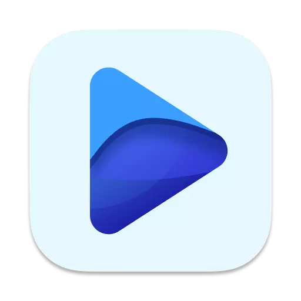
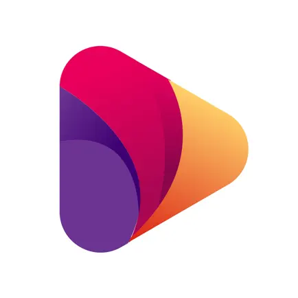

<p align="center">
  
</p>

<h1 align="center">embyExternalUrl</h1>

<p align="center">
  <strong>Supercharge Emby, Jellyfin, Plex, and AList with Cloud Direct-Link Streaming & Universal External Player Integration</strong>
</p>

<p align="center">
  <a href="https://github.com/sohag1192/embyExternalUrl/blob/main/LICENSE"></a>
  
  
  
  
  
  
</p>

<p align="center">
  <a href="README.md"><b>English</b></a> | <a href="README.zh-Hans.md"><b>简体中文</b></a>
</p>

---

## 📖 Overview

**embyExternalUrl** is an all-in-one suite of Nginx NJS reverse proxy scripts and web userscripts that enhances your personal media streaming setup in two major ways:

1. **⚡ Cloud Direct-Link Playback (`emby2Alist` / `plex2Alist`)**:  
   Redirects media requests from Emby, Jellyfin, or Plex directly to cloud drive high-speed direct download links via [AList](https://github.com/alist-org/alist) (supporting 115, Aliyun Drive, Google Drive, OneDrive, Baidu, WebDAV, etc.). This eliminates server bandwidth bottlenecks and offloads heavy transcoding tasks from your home server or NAS.

2. **🎬 Universal External Player Launcher (`embyAddExternalUrl` / `embyWebAddExternalUrl` / `alistWebAddExternalUrl`)**:  
   Allows launching dedicated local video players (such as **PotPlayer**, **VLC**, **MPV**, **IINA**, **Infuse**, **nPlayer**, and **MX Player**) directly from official Emby client apps or web dashboards, delivering full hardware decoding, HDR/Dolby Vision tone-mapping, external subtitle auto-loading, and anime danmaku support.

---

## 🧩 Project Modules

| Module | Type | Description | Documentation |
| :--- | :--- | :--- | :---: |
| **`emby2Alist`** | Nginx NJS Server Proxy | Intercepts Emby / Jellyfin streaming requests and redirects (302) to AList cloud direct links | [Read Guide](./emby2Alist/README.md) |
| **`plex2Alist`** | Nginx NJS Server Proxy | Intercepts Plex streaming requests and redirects (302) to AList cloud direct links | [Read Guide](./plex2Alist/README.md) |
| **`embyAddExternalUrl`** | Nginx NJS Server Filter | Injects external player launch links into Emby metadata API responses for all official clients | [Read Guide](./embyAddExternalUrl/README.md) |
| **`embyWebAddExternalUrl`** | UserScript / Server Injected | Adds customizable external player buttons with official player icons to Emby & Jellyfin Web | [Read Guide](./embyWebAddExternalUrl/README.md) |
| **`alistWebAddExternalUrl`** | UserScript / Custom Header | Adds external player launch buttons to the AList Web interface | [Read Guide](./alistWebAddExternalUrl/README.md) |

---

## 🎯 Supported External Players & Icons

| Icon | Player | Launch Protocol / Scheme | Primary Platforms | Key Features |
| :---: | :--- | :--- | :--- | :--- |
|  | **PotPlayer** | `potplayer://` | Windows | Rich codec support, auto Chinese/external subtitles, multi-instance |
|  | **MPV** | `mpv://` / `mpvplay://` | Windows, macOS, Linux | High quality rendering, custom shaders, requires [mpv-handler](https://github.com/akiirui/mpv-handler) |
|  | **VLC Media Player** | `vlc://` | Windows, macOS, Linux, Android, iOS | Universal cross-platform open-source player |
|  | **IINA** | `iina://` | macOS | Modern macOS native design, Touch Bar & picture-in-picture support |
|  | **Infuse** | `infuse://` | iOS, iPadOS, macOS, tvOS | Premium Apple player, smooth HDR & Dolby Vision playback |
|  | **MX Player** | `intent://` | Android | Industry-standard Android hardware decoding |
|  | **MX Player Pro** | `intent://` | Android | Ad-free professional edition |
|  | **nPlayer** | `nplayer-http://` | iOS, Android | DTS-HD, Dolby audio certified, robust streaming engine |
|  | **DanDanPlay (弹弹Play)** | `ddplay://` | Windows, Android | Synchronous anime danmaku (bullet comments) integration |
|  | **Stellar Player (恒星播放器)** | `stellar://` | Windows, macOS | Built-in HDR tone-mapping, frame rate doubling (SVP alternative) |
|  | **OmniPlayer** | `omniplayer://` | macOS | Powerful macOS all-format media player |
|  | **FigPlayer** | `figplayer://` | macOS | Lightweight modern media player for Mac |
|  | **Fileball** | `fileball://` | iOS | Modern iOS file manager and cloud video player |
|  | **SenPlayer** | `senplayer://` | iOS, tvOS | Clean, lightweight stream player for Apple platforms |
|  | **Copy Stream URL** | Clipboard API | Cross-platform | Copies direct stream / playback URL with authorization tokens |

---

## 🖼️ Visual Previews

### Emby Web Player Buttons
<p align="center">
  <b>Full Mode (Icons + Player Labels)</b><br>
  
</p>

<p align="center">
  <b>Compact Mode (Clean Icons Only)</b><br>
  
</p>

### AList Web Player Buttons
<p align="center">
  
  
</p>

---

## 🚀 Quick Start & Deployment

### 1. Server-Side: Emby External Player Link Injector (`embyAddExternalUrl`)

Injects external player launch links into official Emby client apps:

```bash
cd embyAddExternalUrl
docker-compose up -d
```

- Reverse proxies your upstream Emby server (default `http://172.17.0.1:8096`).
- Exposes port `8097` by default.
- Injects external player links under the media's "External Links" section.
- For detailed setup, see the [embyAddExternalUrl Guide](./embyAddExternalUrl/README.md).

---

### 2. Server-Side: Direct Cloud Streaming (`emby2Alist` / `plex2Alist`)

Redirects media playback requests to AList cloud direct links:

1. Configure `emby2Alist/nginx/conf.d/constant.js` with your AList address and mount paths.
2. Start via Docker:
   ```bash
   cd emby2Alist/docker
   docker-compose up -d
   ```
3. Connect your Emby client to port `8091`. Playback will be 302-redirected to cloud drive direct links.
4. For Plex, follow the [plex2Alist Guide](./plex2Alist/README.md).

---

### 3. Web Client: User Scripts

Enhance the web dashboard of Emby, Jellyfin, or AList:

- **Emby & Jellyfin Web**:
  - Install via [GreasyFork (Script 514529)](https://greasyfork.org/zh-CN/scripts/514529).
  - Or deploy server-side by adding `<script src=".../embyLaunchPotplayer.js" defer></script>` before `</body>` in `dashboard-ui/index.html`.
- **AList Web**:
  - Install via [GreasyFork (Script 494829)](https://greasyfork.org/zh-CN/scripts/494829).
  - Or paste into AList Admin Panel → Settings → Global → Custom Header.

---

## ❓ Frequently Asked Questions (FAQ)

Detailed troubleshooting and advanced configuration patterns can be found in **[FAQ.md](./FAQ.md)**:
- Path mapping (`mediaMountPath` vs `mediaPathMapping`)
- Jellyfin compatibility & differences
- Subtitle extraction (embedded vs external SRT/ASS)
- Transcoding bypass & multi-bitrate settings
- Nginx image caching & cache purging
- 115 Drive concurrent thread and seek rate-limiting solutions

---

## 📄 License

This project is licensed under the [MIT License](./LICENSE).
